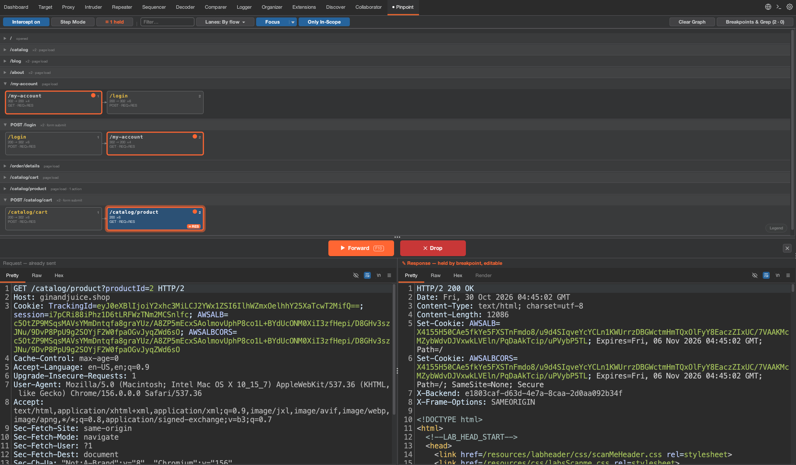

```text
      __               ____  _                   _       __               
     / /              / __ \(_)___  ____  ____  (_)___  / /_              
    / /___________   / /_/ / / __ \/ __ \/ __ \/ / __ \/ __/  ____________
   / /_____/_____/  / ____/ / / / / /_/ / /_/ / / / / / /_   /_____/_____/
  / /              /_/   /_/_/ /_/ .___/\____/_/_/ /_/\__/                
 /_/                            /_/                                       
```


**Pinpoint** is a Burp Suite extension that shows your traffic as a map and lets you pause only the requests you choose, like breakpoints in browser DevTools.

Burp's normal intercept stops everything. Pinpoint stops only the endpoints you mark, and lets the rest of the traffic through.



## Features

* **Traffic map**: every endpoint you visit appears as a card. Cards are grouped by what you did (loading a page, clicking a tab, searching), in the order the calls happened.
* **Breakpoints**: click the dot on a card to pause that endpoint. You can also add rules that match part of a URL, an exact URL, or a regex.
* **Edit and forward**: when a request or response is paused, edit it below the map and click Forward or Drop.
* **Step Mode**: pause every request and response, then send them one at a time to see exactly what the app does.
* **Live Grep**: highlight responses that contain some text or match a regex, in headers or body.
* **Focus**: hide files you don't care about (JS, CSS, images, fonts by default). You choose which types to hide.
* **Scope**: add a host to Burp's scope from the map in one click.

## Install

1. Download the latest `.jar` from [Releases](https://github.com/smavromatis/pinpoint/releases).
2. In Burp Suite, go to `Extensions` > `Installed` > `Add`.
3. Select the `.jar` file. If an older version is loaded, remove it first.

Requires Java 17+ and Burp Suite Community or Professional (a version with the Montoya API).

## Quick start

1. Add your target to Burp's scope.
2. Open the **Pinpoint** tab and use the target in your browser. Cards appear as requests are made.
3. Click a card to see its latest request and response.
4. Click the small circle in a card's top-right corner to set a breakpoint. It turns orange.
5. Repeat the action in the browser. The request pauses and appears under the map.
6. Edit it, then click **Forward** (or press **F10**) or **Drop**.

## Toolbar

| Control | What it does |
|---|---|
| **Intercept on / off** | Turns breakpoints on or off. |
| **Step Mode** | Pauses every visible request and response. Press Forward to send them one by one. |
| **⏸ held** | Shows how many messages are paused. Click it to open the paused message. |
| **Filter** | Shows only cards whose URL (or grep match) contains the text you type. |
| **Lanes** | Groups cards by flow (what you did), by host, or by host and file type, and sets the row order: newest first, first seen, or your own. Drag a row's title to move it. |
| **Focus ▾** | Hides chosen file types. Click the arrow to pick which ones. |
| **Only In-Scope** | Shows only traffic that is in Burp's scope. |
| **Clear Graph** | Removes all cards. Breakpoints and grep rules are kept. |
| **Breakpoints & Grep** | Opens the side panel to add, edit or remove breakpoints and grep rules. |

Hover **Legend** in the bottom-right corner of the map to see what the colours and outlines mean.

## Build from source

```
./gradlew build
```

The `.jar` is created in `build/libs/`.

## License

[GNU General Public License v3 (GPL-3.0)](LICENSE). Copyright (c) 2026 Stylianos Mavromatis.

Found a bug or have an idea? Please open an issue.
